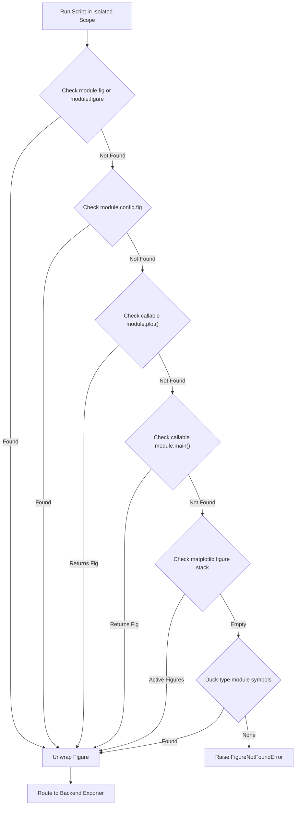

# 📈 Barograph

> **Pure Figure Extraction & Multi-Backend Batch Export Engine**

Barograph is a lean, Unix-focused plot execution and figure-export engine designed for the Frost ecosystem. It runs standalone Python plotting scripts (`plot_*.py`), detects figure objects across multiple rendering backends without boilerplate, batch-exports to interactive HTML and publication-grade vector/raster formats, and exposes a clean, first-class Python library interface (`import barograph`) for conductor tools (e.g. `Glaze`).

---

## ✨ Features

- ⚡ **Zero-Boilerplate Figure Detection Protocol**: Automatically extracts target figures from standalone scripts:
  - `fig` / `figure` module-level attributes
  - `config.fig` (`flaker` `PlotConfigurator` native integration)
  - `plot()` / `main()` callable functions
  - Active `matplotlib.pyplot` figure stack fallback (`plt.get_fignums()`)
  - Duck-typed exported module symbols
- 🎨 **Multi-Backend Export**:
  - **Plotly**: Standalone HTML compilation with CDN runtime and static vector/raster export via Kaleido.
  - **Matplotlib**: Vector SVG/PDF and high-resolution raster PNG/WebP exports.
  - **Seaborn**: Automatically unwraps `Axes`, `FacetGrid`, and `PairGrid` objects to root figures.
  - **Altair & Bokeh**: Interactive HTML and static image export support.
- 📦 **Multi-Backend Batch Rendering (`barograph build`)**:
  - Compiles entire directories of standalone plotting scripts in a single fast pass.
  - Supports `--format html`, `svg`, `png`, `pdf`, `webp`.
  - Gracefully degrades Matplotlib figures from HTML to SVG with terminal alerts.
- 🐍 **First-Class Python Library API**:
  - Direct in-process execution and extraction without shelling out.
  - Returns structured `ExecutionResult` dataclass with figure object, backend type, execution timing, and extracted metadata (title, docstring).
- ❄️ **Frost Ecosystem Integration**:
  - Crystalline terminal interface built on `prism` with ANSI badges, interactive menus, and error diagnostics.
  - Reproducible Nix flake packaging with NixOS and Home Manager modules.

---

## 🐍 Python Library API

Conductor tools and downstream applications can consume figures directly in-process:

```python
from barograph import (
    run_script,
    export_figure,
    discover_plot_scripts,
    extract_figure_from_module,
    detect_backend,
)

# 1. Discover standalone plotting scripts
scripts = discover_plot_scripts("./experiments", pattern="plot*.py")

# 2. Execute script in isolated scope and extract figure
result = run_script(scripts[0])
print(f"Backend: {result.backend}")
print(f"Execution time: {result.execution_time_ms:.1f}ms")
print(f"Title: {result.metadata['title']}")
print(f"Description: {result.metadata['description']}")

# Access the raw root figure (go.Figure, plt.Figure, etc.)
raw_fig = result.figure

# 3. Export figure programmatically
exp = export_figure(
    figure=result.figure,
    output_path="./dist/figure.svg",
    source_script=scripts[0],
    target_format="svg",
    title=result.metadata.get("title"),
)
print(f"Exported to {exp.output_path} (degraded={exp.degraded})")
```

---

## 💻 CLI Usage

```
[📈 barograph] Universal Plot Batch-Runner & Multi-Backend Exporter

Usage:
  barograph                              Open interactive status dashboard & quick actions
  barograph status                       Display host, runtime, backends & script dashboard
  barograph menu                         Open interactive Quick Actions menu
  barograph build [options]              Batch execute and export standalone plotting scripts
  barograph list [options]               Discover and inspect local plotting scripts
  barograph <command> [options]

Interactive & Inspection Commands:
  status                 Display live host, runtime, plot backends & script dashboard
  menu                   Open the interactive Quick Actions menu (alias: dashboard)
  list                   Discover and inspect local plotting scripts (alias: ls)

Build Options:
  -d, --dir DIR          Source directory containing plot scripts (default: current directory)
  -o, --out DIR          Target export directory (default: ./dist)
  -f, --format FMT       Target format: html, svg, png, pdf, webp (default: html)
  -p, --pattern PAT      Script filename glob pattern (default: plot*.py)
  -r, --recursive        Scan subdirectories recursively
  -a, --all              Include all matching scripts regardless of depth

List Options:
  -d, --dir DIR          Source directory to inspect (default: current directory)
  -p, --pattern PAT      Script filename glob pattern (default: plot*.py)
  -r, --recursive        Scan subdirectories recursively
  -a, --all              Include all matching scripts regardless of depth

General Options:
  --color MODE           Color output mode: auto, always, never (default: auto)
  --no-color             Disable colored output
  -v, --verbose          Show detailed error traces and internal execution timings
  -h, --help             Show this help message and exit
  -V, --version          Show version information and exit
```

### CLI Examples

```bash
# Batch export all plot*.py scripts to ./dist as standalone HTML
nix run github:SpanishSyntax/Barograph -- build

# Batch export to high-resolution vector SVGs
nix run github:SpanishSyntax/Barograph -- build --format svg --out ./figures

# Batch export to vector PDFs for Typst or LaTeX
nix run github:SpanishSyntax/Barograph -- build --format pdf --out ./dist/pdf

# Inspect discovered scripts in current workspace
nix run github:SpanishSyntax/Barograph -- list

# View host, runtime, and detected backends
nix run github:SpanishSyntax/Barograph -- status
```

---

## 📐 Figure Detection Protocol

Barograph does not force users to wrap their code in rigid frameworks or inherit from proprietary classes. It inspects script scopes dynamically using the following prioritized protocol:



---

## ❄️ NixOS & Home Manager Configuration

Add Barograph to your system flake inputs:

```nix
{
  inputs = {
    nixpkgs.url = "github:nixos/nixpkgs/nixos-unstable";
    barograph.url = "github:SpanishSyntax/Barograph";
  };
}
```

### NixOS Module
```nix
{
  programs.barograph.enable = true;
}
```

### Home Manager Module
```nix
{
  programs.barograph = {
    enable = true;
  };
}
```

---

## 📄 License

MIT © [SpanishSyntax](https://github.com/SpanishSyntax)
