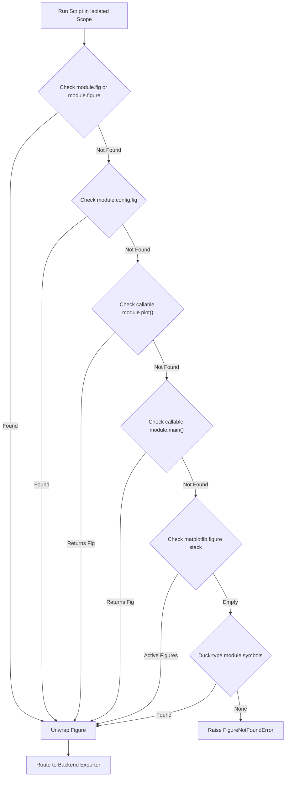

# Barograph 📈

> **Universal Plot Batch-Runner, Multi-Backend Exporter & Live-Reloading Preview Server**

Barograph is a fast, streamlined CLI tool designed for the Frost ecosystem to run standalone Python plotting scripts (`plot_*.py`), detect figures across multiple rendering backends without boilerplate, batch export to HTML/vector/raster formats, and serve interactive live-reloading dashboards with instant browser sync.

---

## ✨ Features

- ⚡ **Zero-Boilerplate Protocol**: Automatically extracts target figures from standalone scripts:
  - `fig` / `figure` module-level attributes
  - `config.fig` (`flaker` MathVis `PlotConfigurator` native integration)
  - `plot()` / `main()` callable functions
  - Active `matplotlib.pyplot` figure stack fallback (`plt.get_fignums()`)
- 🎨 **Multi-Backend Support**:
  - **Plotly**: Full-viewport HTML compilation with CDN runtime and static export via Kaleido.
  - **Matplotlib**: Vector SVG/PDF and high-resolution raster PNG/WebP exports.
  - **Seaborn**: Unwraps Seaborn `Axes` and `FacetGrid`/`PairGrid` objects directly to root figures.
- 🔄 **Live-Reloading Preview Server (`barograph serve`)**:
  - Serves dynamic HTML preview on localhost with automatic port discovery (`--port 0`).
  - Watches target `.py` scripts and re-compiles instantly on modification.
  - Injects auto-reload synchronization script via non-intrusive polling.
  - Automatically pops the default browser on start (`--no-open` to disable).
- 📦 **Batch Export Engine (`barograph build`)**:
  - Compiles entire directories of standalone plotting scripts in one pass.
  - Supports `--format html`, `svg`, `png`, `pdf`, `webp`.
  - Gracefully degrades Matplotlib figures from HTML to SVG with terminal alerts.
- ❄️ **Frost Ecosystem Integration**:
  - Crystalline terminal interface built on `prism` with ANSI badges, spinners, and error panels.
  - Reproducible Nix flake packaging with NixOS and Home Manager modules.

---

## 🚀 Quick Start

Run Barograph directly via Nix without manual installation:

```bash
# Serve plot.py or first detected script with hot reload
nix run github:SpanishSyntax/Barograph -- serve

# Batch export all plot*.py scripts to ./dist as HTML
nix run github:SpanishSyntax/Barograph -- build

# Batch export to high-res vector SVGs
nix run github:SpanishSyntax/Barograph -- build --format svg --out ./figures

# Inspect discovered scripts in current directory
nix run github:SpanishSyntax/Barograph -- list
```

---

## 💻 CLI Commands & Options

```
[📈 barograph] Universal Plot Batch-Runner, Multi-Backend Exporter & Preview Server

Usage:
  barograph build [options]              Batch execute and export standalone plotting scripts
  barograph serve [target] [options]     Live-reload preview server with browser sync
  barograph list [options]               Discover and inspect local plotting scripts

Build Options:
  -d, --dir DIR          Source directory containing plot scripts (default: current directory)
  -o, --out DIR          Target export directory (default: ./dist)
  -f, --format FMT       Target format: html, svg, png, pdf, webp (default: html)
  -p, --pattern PAT      Script filename glob pattern (default: plot*.py)
  -r, --recursive        Scan subdirectories recursively
  --all                  Include all matching scripts regardless of depth

Serve Options:
  [target]               Script (e.g. plot_traj.py) or .html file (default: auto-detected)
  -p, --port PORT        Port to bind HTTP server to (default: 0 for ephemeral port)
  --host HOST            Host to bind HTTP server to (default: 127.0.0.1)
  --no-open              Do not automatically open the dashboard in browser

General Options:
  --color MODE           Color output mode: auto, always, never (default: auto)
  --no-color             Disable colored output
  -v, --verbose          Show detailed error traces and internal execution timings
  -h, --help             Show this help message and exit
  -V, --version          Show version information and exit
```

---

## 📐 Figure Detection Protocol

Barograph does not force users to wrap their code in rigid frameworks or import proprietary classes. It inspects script scopes dynamically using the following prioritized protocol:



### Supported Patterns

#### 1. Plotly Direct Assignment
```python
import plotly.graph_objects as go

fig = go.Figure(data=go.Scatter(x=[1, 2, 3], y=[4, 1, 2]))
fig.update_layout(title="Trajectory")
```

#### 2. Flaker MathVis `PlotConfigurator`
```python
import plotly.graph_objects as go
from plotter import PlotConfigurator

config = PlotConfigurator()
fig = config.fig
fig.add_trace(go.Scatter(x=[0, 1], y=[0, 1]))
```

#### 3. Callable `plot()` or `main()`
```python
import plotly.graph_objects as go

def plot():
    return go.Figure(data=go.Bar(x=["A", "B"], y=[10, 20]))
```

#### 4. Standard Matplotlib & Seaborn
```python
import matplotlib.pyplot as plt
import numpy as np

t = np.linspace(0, 10, 100)
plt.plot(t, np.sin(t))
plt.title("Harmonic Oscillator")
# No plt.show() needed! Barograph captures the active figure stack.
```

---

## ❄️ NixOS & Home Manager Configuration

Add Barograph to your system flake inputs:

```nix
{
  inputs = {
    nixpkgs.url = "github:nixos/nixpkgs/nixos-unstable";
    barograph.url = "github:SpanishSyntax/Barograph";
  };
}
```

### NixOS Module
```nix
{
  programs.barograph.enable = true;
}
```

### Home Manager Module
```nix
{
  programs.barograph = {
    enable = true;
  };
}
```

---

## 📄 License

MIT © [SpanishSyntax](https://github.com/SpanishSyntax)
