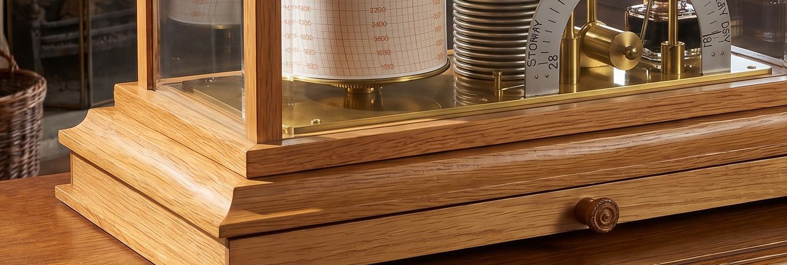
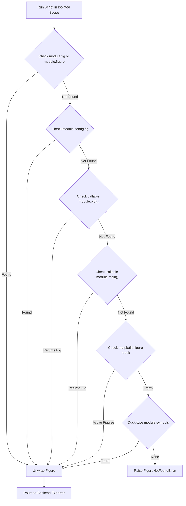

<p align="center">
  
</p>

# Barograph 📈

> Pure Figure Extraction & Multi-Backend Batch Export Engine

Barograph is a lean, Unix-focused plot execution and figure-export engine designed for the Frost ecosystem. It runs standalone Python plotting scripts (`plot_*.py`), detects figure objects across multiple rendering backends without boilerplate, batch-exports to interactive HTML and publication-grade vector/raster formats, and exposes a clean, first-class Python library interface for conductor tools.

[](https://spanishsyntax.github.io/Barograph)
[](LICENSE)

---

## Why "Barograph"? (The Lore)

> **barograph** (`/ˈbær.ə.ɡræf/`) — *noun:* A recording barometer that continuously charts atmospheric pressure variations on a revolving drum, alerting polar navigators to incoming arctic fronts and pressure drops before the blizzard hits.

On polar expeditions, weather changes violently and without warning. Navigators cannot afford to guess at atmospheric gradients; they rely on the barograph's needle to register microscopic pressure fluctuations before the whiteout descends.

Barograph acts as the plotting and telemetry needle:
- **Pure Recording**: Executes standalone plotting scripts without runtime ceremony, capturing figures across Matplotlib, Seaborn, Plotly, Altair, and Bokeh backends.
- **Storm-Proof Export**: Batch-exports figures to publication-grade vector formats and interactive HTML canvases with deterministic, repeatable precision.

---

## Features

- **Zero-Boilerplate Figure Detection Protocol**: Automatically extracts target figures from standalone scripts:
  - `fig` / `figure` module-level attributes
  - `config.fig` (`flaker` `PlotConfigurator` native integration)
  - `plot()` / `main()` callable functions
  - Active `matplotlib.pyplot` figure stack fallback (`plt.get_fignums()`)
  - Duck-typed exported module symbols
- **Multi-Backend Export**:
  - **Plotly**: Standalone HTML compilation with CDN runtime and static vector/raster export via Kaleido.
  - **Matplotlib**: Vector SVG/PDF and high-resolution raster PNG/WebP exports.
  - **Seaborn**: Automatically unwraps `Axes`, `FacetGrid`, and `PairGrid` objects to root figures.
  - **Altair & Bokeh**: Interactive HTML and static image export support.
- **Multi-Backend Batch Rendering**: Compiles entire directories of standalone plotting scripts in a single fast pass with automatic format degradation alerts.
- **First-Class Python Library API**: Direct in-process execution and extraction without shelling out, returning structured `ExecutionResult` dataclasses with execution timing and extracted metadata.
- **Model Context Protocol (MCP)**: Native stdio server exposing plot execution, batch compilation, and figure discovery tools to AI agents.

---

## Documentation

Full documentation, architecture diagrams, CLI recipes, and API references are available on the **[Documentation Site](https://spanishsyntax.github.io/Barograph)**:

- [Getting Started](https://spanishsyntax.github.io/Barograph/#/getting-started)
- [Architecture & Extraction Pipeline](https://spanishsyntax.github.io/Barograph/#/architecture)
- [CLI Reference & Recipes](https://spanishsyntax.github.io/Barograph/#/usage)
- [Python API Reference](https://spanishsyntax.github.io/Barograph/#/api)

---

## Quick Start

### 1. Execute Script In-Process via Python API

```python
from barograph import run_script, export_figure

# Execute script in isolated scope and extract figure
result = run_script("plot_trajectory.py")
print(f"Backend: {result.backend} in {result.execution_time_ms:.1f}ms")

# Export figure programmatically
exp = export_figure(
    figure=result.figure,
    output_path="./dist/figure.svg",
    target_format="svg",
)
```

### 2. Batch Export via CLI

```bash
# Batch export all plot*.py scripts to ./dist as standalone HTML
barograph build -d ./experiments -o ./dist -f html

# Batch export to high-resolution vector SVGs
barograph build -d ./experiments -o ./figures -f svg

# Batch export to vector PDFs for Typst or LaTeX
barograph build -d ./experiments -o ./dist/pdf -f pdf
```

---

## CLI Overview

```text
Usage:
  barograph                              Open interactive status dashboard & quick actions
  barograph status                       Display host, runtime, backends & script dashboard
  barograph menu                         Open interactive Quick Actions menu
  barograph build [options]              Batch execute and export standalone plotting scripts
  barograph list [options]               Discover and inspect local plotting scripts
  barograph mcp                          Run Model Context Protocol stdio server

Build Options:
  -d, --dir DIR          Source directory containing plot scripts (default: current directory)
  -o, --out DIR          Target export directory (default: ./dist)
  -f, --format FMT       Target format: html, svg, png, pdf, webp (default: html)
  -p, --pattern PAT      Script filename glob pattern (default: plot*.py)
  -r, --recursive        Scan subdirectories recursively
  -a, --all              Include all matching scripts regardless of depth
```

---

## Figure Detection Protocol



---

## Nix Flake Configuration

```nix
{
  inputs = {
    nixpkgs.url = "github:nixos/nixpkgs/nixos-unstable";
    barograph.url = "github:SpanishSyntax/Barograph";
    barograph.inputs.nixpkgs.follows = "nixpkgs";
  };
}
```

### Home Manager Module

```nix
{
  programs.barograph = {
    enable = true;
  };
}
```

---

## License

MIT © [SpanishSyntax](https://github.com/SpanishSyntax)
