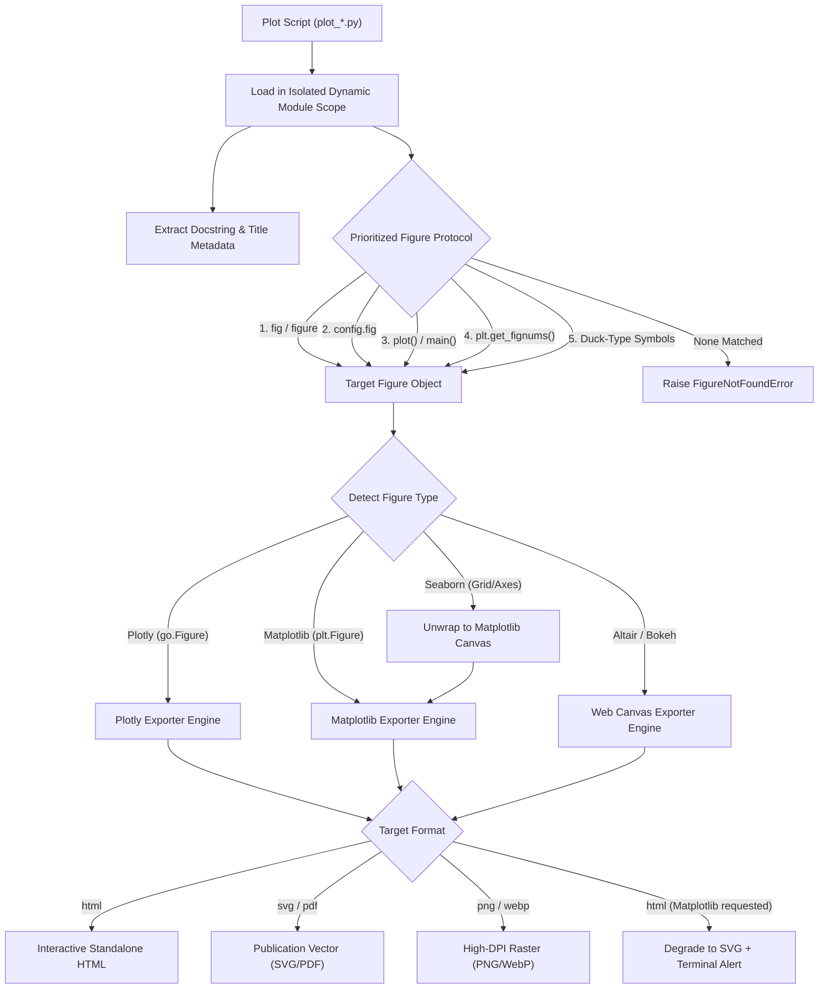

# Architecture & Pipeline

Barograph isolates script execution, applies a tiered figure discovery protocol, routes figures to format-specific exporters, and handles graceful degradation.

---

## Extraction Pipeline

When Barograph compiles a script or directory of scripts, it executes each file in an isolated Python interpreter context:

---

## Figure Protocol Priority

Barograph prioritizes non-invasive discovery mechanisms in strict order:

1. **`module.fig` / `module.figure`**: The most direct convention in scientific and machine learning scripts.
2. **`module.config.fig`**: Compatible with the `flaker` `PlotConfigurator` standard used throughout the Frost ecosystem.
3. **`module.plot()` / `module.main()`**: If the script encapsulates plotting logic inside a function, Barograph invokes it and inspects the return value.
4. **Matplotlib Global Figure Stack**: If the script calls `plt.plot()` or `plt.figure()` without assigning a variable, Barograph queries `matplotlib.pyplot.get_fignums()` to grab the active figure.
5. **Duck-Typing**: Barograph scans all exported attributes for methods like `.write_html`, `.savefig`, or `.to_html`.

---

## Isolated Execution Scope

To avoid cross-script variable leakage, namespace pollution, or shared matplotlib state:
- Each script is assigned a fresh module scope (`types.ModuleType`).
- Global matplotlib figures are cleared between runs (`plt.close('all')`).
- Execution duration is measured with microsecond accuracy using `time.perf_counter()`.
- Standard error and standard output can be silenced or captured into structured logs.

---

## Multi-Backend Exporters

### Plotly Exporter
- **HTML**: Inlines the Plotly JavaScript bundle via CDN or embedded script tags. Emits responsive `
` containers that adjust to parent container dimensions.
- **Static Vector / Raster**: Dispatches through `kaleido` with configurable DPI, width, and height bounds.

### Matplotlib / Seaborn Exporter
- **SVG**: Emits scalable vector graphics with embedded fonts (`svg.fonttype: none` or `path`), ensuring sharp rendering in Typst or LaTeX publications.
- **PDF**: Emits clean PDF vectors with tight bounding boxes (`bbox_inches="tight"`).
- **Raster**: Emits 300 DPI PNG or WebP images with transparent or solid background options.

---

## Graceful Degradation

If a user requests `--format html` for a script written in Matplotlib or Seaborn, Barograph does not fail or crash. Instead, it:
1. Automatically degrades the export to high-resolution vector SVG.
2. Wraps the SVG in a responsive HTML envelope.
3. Logs a clean informational alert indicating that the Matplotlib plot was converted to vector SVG.
